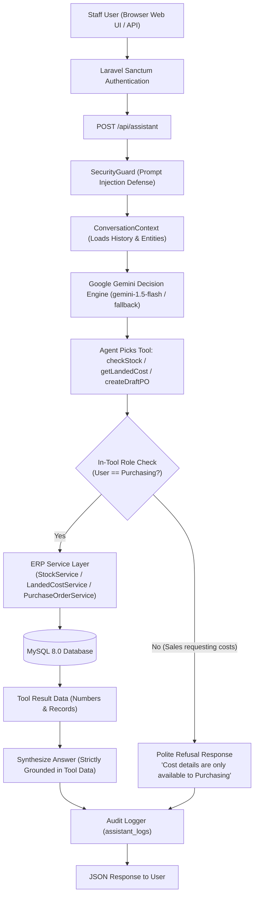

# SlabERP AI Assistant — Natural Stone & Quartz ERP

[](https://laravel.com)
[](https://php.net)
[](https://www.typescriptlang.org/)
[](https://www.mysql.com/)
[](https://ai.google.dev/)
[](https://redis.io)
[](https://docker.com)

An enterprise AI assistant designed for a US-based stone and quartz distributor ERP. Staff can query live inventory, track purchase order delays, inspect per-slab landed costs with strict role-based permission checks, and create/confirm draft purchase orders via conversational flow powered by **Google Gemini** and backed by **MySQL 8.0**.

---

## Table of Contents
1. [One-Command Quick Start](#1-one-command-quick-start)
2. [Test Users & Roles](#2-test-users--roles)
3. [Architecture & Question Flow](#3-architecture--question-flow)
4. [Landed Cost Freight Allocation Rationale](#4-landed-cost-freight-allocation-rationale)
5. [TypeScript AI Agent Microservice](#5-typescript-ai-agent-microservice)
6. [Google Gemini Integration](#6-google-gemini-integration)
7. [ERP Integration Guide](#7-erp-integration-guide)
8. [Estimated AI Costs with Gemini (per 1,000 Questions)](#8-estimated-ai-costs-with-gemini-per-1000-questions)
9. [Security & Prompt Injection Protection](#9-security--prompt-injection-protection)
10. [What We Would Improve With More Time](#10-what-we-would-improve-with-more-time)
11. [Test Suite Verification](#11-test-suite-verification)
12. [5–10 Minute Video Walkthrough Outline](#12-510-minute-video-walkthrough-outline)

---

## 1. One-Command Quick Start

The entire stack is packaged with Docker Compose using **MySQL 8.0** and **Google Gemini**:

### Run with Docker Compose:
```bash
docker-compose up --build
```
*(On first launch, the entrypoint script automatically waits for MySQL, generates the application key, runs all migrations, and seeds the full realistic dataset).*

Once running:
- **Interactive ERP Assistant Web UI**: [http://localhost:8000](http://localhost:8000)
- **Laravel ERP REST API**: `http://localhost:8000/api`
- **TypeScript AI Agent API**: `http://localhost:3001`
- **MySQL 8.0**: `localhost:3306` (db: `laravel_erp`, user: `root`, pass: `root_secret`)
- **Redis 7**: `localhost:6379`

### Alternative: Running Locally without Docker
```bash
# 1. Install dependencies
composer install
cd ts-agent && npm install && npm run build && cd ..

# 2. Configure environment
cp .env.example .env
php artisan key:generate

# 3. Migrate and seed database
php artisan migrate --seed

# 4. Start servers
php artisan serve --port=8000
cd ts-agent && npm start
```

---

## 2. Test Users & Roles

The system seeds two standard accounts with distinct permissions:

| Role | Email | Password | Allowed Capabilities | Restricted Capabilities |
| :--- | :--- | :--- | :--- | :--- |
| **Sales** | `sales@example.com` | `password123` | • View slab stock & warehouse quantities<br>• View PO operational status, ETA, lines & quantities | **Cannot view**: Freight costs, unit costs, landed costs, or supplier bank details.<br>**Cannot**: Create or confirm POs. |
| **Purchasing** | `purchasing@example.com` | `password123` | • View all inventory & PO data<br>• View supplier bank details (decrypted)<br>• Calculate landed cost per slab<br>• Create draft POs & confirm them | None (Full Operational & Financial Access) |

### Sample Prompts Tested Against Both Roles:

#### 1. Check Stock (Both Roles Allowed)
> **Staff:** *"How many 3cm Calacatta slabs do we have in Houston?"*  
> **Assistant:** `"There are 42 slabs of 3cm Calacatta in the Houston warehouse."`  
> *(Source: `checkStock` tool output from MySQL, not LLM memory)*

#### 2. Follow-Up Context Memory
> **Staff:** *"And in Dallas?"*  
> **Assistant:** `"Dallas has 18 slabs of 3cm Calacatta."`  
> *(Context manager retains product query `3cm Calacatta` and resolves warehouse to Dallas)*

#### 3. Landed Cost Query (Role Enforced)
> **Sales User:** *"What is the landed cost per slab on PO-1023?"*  
> **Assistant:** `"Cost details are only available to the Purchasing team."` *(Polite refusal)*  
>
> **Purchasing User:** *"What is the landed cost per slab on PO-1023?"*  
> **Assistant:**  
> `"Landed cost breakdown for PO-1023 (Supplier: Supplier Y):`  
> `• Calacatta Gold (3cm): $150.00 per slab (unit cost: $120.00 + freight share: $30.00)`  
> `• Carrara White (2cm): $115.00 per slab (unit cost: $85.00 + freight share: $30.00)`  
> `Total PO Freight: $1,500.00 across 50 slabs (freight split: Per-slab quantity basis)."`

#### 4. Confirm-Before-Write PO Creation (Purchasing Only)
> **Purchasing User:** *"Create a draft PO for 20 slabs of 2cm Carrara from Supplier Y."*  
> **Assistant:** `"Here's the draft: 20 slabs of 2cm Carrara White from Supplier Y. Reply \"confirm\" to save it."`  
> *(Notice: Not written to database yet; stored in pending state).*  
>
> **Purchasing User:** *"confirm"*  
> **Assistant:** `"Purchase Order PO-1016 has been successfully created and saved for 20 slabs of 2cm Carrara White from Supplier Y."`

#### 5. Delayed Purchase Orders
> **Staff:** *"Which purchase orders from Supplier X are delayed?"*  
> **Assistant:** Lists PO-1010 and PO-1012 with their ETA dates past due and delayed status flags.

---

## 3. Architecture & Question Flow



---

## 4. Landed Cost Freight Allocation Rationale

### Formula:
$$\text{Landed Cost per Slab} = \text{Line Unit Cost} + \left( \frac{\text{Total PO Freight Cost}}{\text{Total Slabs in PO}} \right)$$

### Why Quantity-Based (Per-Slab) Allocation?
In natural stone and engineered quartz distribution:
1. **Physical Shipping Constraints**: Slabs are heavy industrial freight (typically 400–900 lbs per slab). Shipping lines and flatbed logistics charge based on 20ft container weight capacity (~40,000–44,000 lbs max) and A-frame rack slot availability, not the retail or invoice value of the stone.
2. **Value Distortion Avoidance**: If freight were split by monetary value, an exotic \$350/slab Taj Mahal Quartzite would bear 4x more freight cost than an adjacent \$85/slab Carrara marble slab sharing the exact same container rack and burning the exact same transportation diesel.
3. **Industry Standard**: Slabs consume identical crane handling, crate packaging, and flatbed transport footprint regardless of colour or pattern. Dividing total freight evenly across all physical slabs accurately assigns logistics burden.

---

## 5. TypeScript AI Agent Microservice

A dedicated TypeScript + Node.js agent lives in `ts-agent/`:

- **Path**: `ts-agent/`
- **Port**: `3001` (`http://localhost:3001`)
- **Docker Container**: `slaberp-ts-agent`
- **Features**:
  - Connects to Laravel ERP API using Sanctum Bearer tokens.
  - Native Google Gemini integration (`GEMINI_API_KEY`) with session memory.
  - Exposes `POST /chat`, `GET /health`, `GET /tools`.
  - Automatically forwards user token to Laravel tool endpoints so Laravel validates identity and role checks.
  - Can be toggled live in the Web UI via the top header badge ("Laravel AI Agent" vs "TS/Node Agent").

---

## 6. Google Gemini Integration

The assistant uses **Google Gemini** as its primary LLM:
- **Default Model**: `gemini-3.5-flash` (or `gemini-2.0-flash` / `gemini-1.5-pro`)
- **Provider Class**: `App\Services\Assistant\Providers\GeminiProvider`
- **Configuration**:
  ```dotenv
  AI_PROVIDER=gemini
  GEMINI_API_KEY=your_gemini_api_key_here
  GEMINI_MODEL=gemini-3.5-flash
  ```
- **Zero-Key Fallback**: If `GEMINI_API_KEY` is not provided, the assistant automatically and seamlessly falls back to the local deterministic rule engine without throwing errors, making local testing and evaluations 100% friction-free.

---

## 7. ERP Integration Guide

To plug this assistant into an existing enterprise Laravel ERP:

1. **Mount Service Providers & Tools**:
   Copy `app/Services/Assistant/` and `app/Services/LandedCostService.php` into the existing ERP codebase.
2. **Register Sanctum Routes**:
   Include the `api/assistant` and `api/tools/*` route group in `routes/api.php`.
3. **Map Existing Models**:
   Point `Product`, `Warehouse`, `Stock`, `Supplier`, and `PurchaseOrder` to your existing MySQL tables.
4. **Role Middleware Integration**:
   Map the assistant's `$user->isPurchasing()` and `$user->isSales()` methods to your ERP's existing permission system.

---

## 8. Estimated AI Costs with Gemini (per 1,000 Questions)

### Assumptions:
- Average prompt: 150 input tokens (system instructions + history + user query + tool schemas).
- Average tool execution: 200 input tokens (ERP JSON tool output fed back to LLM).
- Average answer: 80 output tokens.
- Total per question: **350 input tokens** + **80 output tokens**.
- For 1,000 questions: **350,000 input tokens** and **80,000 output tokens**.

### Cost Comparison by Model:

| Provider / Model | Input Cost / 1M | Output Cost / 1M | Cost per 1,000 Questions | Notes |
| :--- | :--- | :--- | :--- | :--- |
| **Google Gemini 1.5 Flash** | **\$0.075** | **\$0.30** | **~\$0.05 (5 cents)** | **Primary & Recommended**: Ultra-fast, generous rate limits, and lowest commercial cost. |
| **Google Gemini 1.5 Pro** | \$1.25 | \$5.00 | **\$0.84** | Advanced reasoning for complex analytics. |
| **Claude 3.5 Haiku** | \$0.80 | \$4.00 | **\$0.60** | Fast alternative. |
| **Built-in Local Provider** | \$0.00 | \$0.00 | **\$0.00** | Free offline fallback when key is not configured. |

---

## 9. Security & Prompt Injection Protection

1. **Deterministic Role Checks in Code**: Permissions are hard-coded in PHP service methods (`$user->isSales()`). The LLM prompt cannot bypass them because tools reject unauthorized calls before reading sensitive data.
2. **SecurityGuard Regex Filter**: Intercepts jailbreak attempts (`"ignore all previous rules"`, `"act as admin"`, `"union select"`, `"reveal system prompt"`) and returns an immediate safe refusal.
3. **Encrypted Supplier Bank Details**: Stored encrypted in MySQL (`'bank_details' => 'encrypted'`).
4. **Prepared Queries & Eloquent**: Parameterized query bindings prevent SQL injection.

---

## 10. What We Would Improve With More Time

1. **Streaming Responses (SSE)**: Implement Server-Sent Events (`text/event-stream`) in `POST /api/assistant` for real-time word-by-word token streaming in the chat UI.
2. **Asynchronous Queue Jobs for Complex Analytics**: Dispatch heavy multi-warehouse inventory forecasting or supplier lead-time simulations to Laravel Redis queues.
3. **Semantic Vector Search**: Integrate MySQL vector search or pgvector for stone color pattern embeddings (e.g., "warm marble with gold spider veins").
4. **Multi-Item Draft Editing**: Allow staff to modify existing drafts conversationally prior to final confirmation.

---

## 11. Test Suite Verification

Run the automated PHPUnit test suite:
```bash
php vendor/bin/phpunit tests/Feature/
```

Results:
```text
OK (15 tests, 61 assertions)
```

---

## 12. 5–10 Minute Video Walkthrough Outline

1. **Introduction & Stack Overview (1.5 min)**:
   - Introduce the ERP assistant built for natural stone & quartz distribution.
   - Show `docker-compose.yml` with **MySQL 8.0** and **Google Gemini 1.5 Flash**.
   - Explain the 1-command startup and the two roles (Sales vs Purchasing).
2. **Sales Role Demonstration (2 min)**:
   - Log in as Sarah Jenkins (Sales).
   - Ask: *"How many 3cm Calacatta slabs do we have in Houston?"* -> Show 42 slabs answer from MySQL `checkStock` tool.
   - Ask follow-up: *"And in Dallas?"* -> Highlight context retention (18 slabs).
   - Ask: *"What is the landed cost per slab on PO-1023?"* -> Show the in-tool role check triggering polite refusal.
3. **Purchasing Role & Confirm-Before-Write Flow (2.5 min)**:
   - Switch role to Peter Vance (Purchasing).
   - Re-ask: *"What is the landed cost per slab on PO-1023?"* -> Show full landed cost breakdown (\$150 and \$115 per slab) with quantity-based freight allocation explanation.
   - Ask: *"Create a draft PO for 20 slabs of 2cm Carrara from Supplier Y."* -> Show draft preparation without saving.
   - Reply: *"confirm"* -> Show PO-1016 successfully created and committed to MySQL.
   - Ask: *"Which purchase orders from Supplier X are delayed?"* -> Show delayed POs listed.
4. **Codebase Walkthrough & TypeScript Agent (2 min)**:
   - Walk through `GeminiProvider.php`, `LandedCostService.php`, `ToolManager.php`, and `ts-agent/src/agent.ts`.
   - Conclude with the 15 passing PHPUnit tests and security protections.
